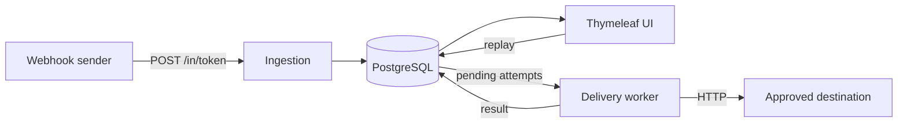

# HookDock

A self-hosted webhook inspector for developers: capture, inspect, forward and replay HTTP webhooks, with full delivery history.

Point GitHub, Stripe or any other webhook sender at a HookDock URL and you get:

- the exact request that was sent (raw body bytes, headers, query string, timestamp)
- optional forwarding to your own service, with the response, status code, latency or error recorded for every attempt
- one-click replay of a captured event once you've fixed your handler

HookDock is a single Spring Boot application backed by PostgreSQL, or by a local H2 file when you just want to try it out. It is meant for individual developers and small teams who want something simple they can run themselves.

## Features

- **Projects and endpoints.** Each endpoint gets a random 256-bit receive URL (`/in/<token>`). Only a SHA-256 hash of the token is stored; the URL is shown once on creation.
- **Capture.** Raw request bytes are stored as received, so form bodies and signed payloads survive byte for byte. Credential headers (`Authorization`, `Cookie`, ...) are redacted before they are saved. Bodies over the size limit get a `413`.
- **Rate limiting.** Each endpoint accepts at most 20 requests in any rolling minute by default, and the limit can be changed per endpoint on the project page. Responses carry `RateLimit-Limit`, `RateLimit-Remaining` and `RateLimit-Reset` headers. Requests over the limit get a `429` with a `Retry-After` header and are not stored or forwarded, so a runaway test script can't flood the database. Recent rejections are listed on the dashboard. See [Rate limiting](#rate-limiting).
- **Inspection.** Paginated event list per project, event detail page with headers, query string, raw body and pretty-printed JSON. Common providers (GitHub, Stripe, Shopify, Slack) are detected from their headers.
- **Approved destinations.** Forwarding and replay only send to destinations saved on the project. URLs are checked against an outbound policy (scheme, port, credentials in the URL, and every resolved IP must be public) when they are saved and again before each send.
- **Forwarding.** An endpoint can forward each captured event to a destination. Deliveries are queued in the database in the same transaction as the capture and sent by a background worker. Redirects are never followed.
- **Replay.** Re-send any captured event to an approved destination. Each replay is a new `MANUAL_REPLAY` attempt that records who requested it. The original event is never modified.
- **Delivery history.** Every attempt records trigger, status, HTTP status, duration, response headers, a response body excerpt and an error category. Capture status and delivery status are shown separately.
- **Accounts.** Form login backed by Spring Security, with CSRF protection on every form. Projects are only visible to their owner.

## Quick start

The quickest way needs only JDK 21, no Docker or PostgreSQL:

```bash
cp .env.example .env        # then fill in the admin credentials
set -a; source .env; set +a
./mvnw spring-boot:run
```

With `HOOKDOCK_DB_URL` left empty, HookDock stores everything in a local H2 file, `data/hookdock.mv.db` in the folder you start it from, and logs a warning saying so. H2 runs in PostgreSQL mode with the same migrations. To start over, stop the app and delete the `data/` folder. The file is only meant for trying HookDock out and local development; use PostgreSQL for anything you rely on.

To use PostgreSQL locally, set `HOOKDOCK_DB_URL=jdbc:postgresql://localhost:5432/hookdock` and the DB username and password in `.env`, then:

```bash
docker compose up -d postgres
set -a; source .env; set +a
./mvnw spring-boot:run
```

Or run everything in containers (this always uses PostgreSQL):

```bash
docker compose --profile app up --build
```

Open http://localhost:8080 and sign in with `HOOKDOCK_ADMIN_USERNAME` / `HOOKDOCK_ADMIN_PASSWORD` from your `.env`. The admin account is only created the first time the app starts with an empty user table.

If you got the code from a zip file rather than `git clone`, `./mvnw` and the scripts may have lost their executable bit and fail with `Permission denied`. Run `chmod +x mvnw scripts/*.sh scripts/*.py`, or call them through their interpreter instead (`sh mvnw ...`, `bash scripts/send-sample-webhook.sh ...`, `python3 scripts/load_test.py ...`). The Docker build sets the bit itself, so `docker compose --profile app up --build` works either way.

Then:

1. Create a project and add an endpoint. Copy the receive URL - it is only shown once.
2. Send something to it:

   ```bash
   ./scripts/send-sample-webhook.sh http://localhost:8080/in/<token>
   ```

3. Open the project's events page to inspect it.

### Sending a batch of test requests

`scripts/load_test.py` sends a series of JSON webhooks to a receive URL and prints the outcome of each one (captured, rate limited, not found, too large or connection error) with a summary at the end. Each line also shows the endpoint's `RateLimit-Limit`, `RateLimit-Remaining` and `RateLimit-Reset` headers, or `-` when the response has none (for example a `404`). It only needs Python 3.8+, no extra packages, and works on macOS, Linux and Windows.

```bash
python3 scripts/load_test.py http://localhost:8080/in/<token> --count 50 --delay 0.1
```

On Windows, run it with `py` or `python` instead of `python3`. `--count` is the number of requests (default 10), `--delay` is the pause between requests in seconds (default 0.5, use 0 for none) and `--timeout` is the per-request timeout (default 10). Each request body includes its sequence number, so you can match the results to captured events.

### Trying forwarding locally

The outbound policy blocks loopback and private addresses unless `HOOKDOCK_ALLOW_PRIVATE_DESTINATIONS=true`. `.env.example` sets it to `true` so you can forward to a service on your own machine straight away. Add a destination like `http://localhost:9000/webhooks` (or `http://host.docker.internal:9000/webhooks` when HookDock runs in Docker), pick it in the endpoint's "Forward to" dropdown, and send another event.

Set it to `false` on any HookDock instance that other people can reach. If the variable isn't set at all, it defaults to `false`.

## Configuration

All configuration comes from environment variables (see `.env.example`). `.env` is gitignored; never commit it.

| Variable | Default | Purpose |
| --- | --- | --- |
| `HOOKDOCK_DB_URL` | _(none)_ | PostgreSQL JDBC URL, e.g. `jdbc:postgresql://localhost:5432/hookdock`. When empty, a local H2 file database is used |
| `HOOKDOCK_LOCAL_DB_PATH` | `./data/hookdock` | Where the local H2 database is stored when `HOOKDOCK_DB_URL` is empty (H2 adds `.mv.db`) |
| `HOOKDOCK_DB_USERNAME` | `hookdock` | Database user |
| `HOOKDOCK_DB_PASSWORD` | _(none)_ | Database password |
| `HOOKDOCK_ADMIN_USERNAME` | _(none)_ | First admin account, created only if no users exist |
| `HOOKDOCK_ADMIN_PASSWORD` | _(none)_ | Password for the first admin account |
| `HOOKDOCK_ALLOW_PRIVATE_DESTINATIONS` | `false` | Allow sending to loopback/private IPs (local dev only) |
| `HOOKDOCK_MAX_BODY_SIZE` | `1MB` | Largest inbound body that will be captured |
| `HOOKDOCK_RATE_LIMIT_ENABLED` | `true` | Turn the per-endpoint rate limit on or off |
| `HOOKDOCK_RATE_LIMIT_REQUESTS` | `20` | Default for the most requests an endpoint may accept in any rolling period (can be overridden per endpoint) |
| `HOOKDOCK_RATE_LIMIT_PERIOD` | `1m` | Length of the rolling window (e.g. `30s`, `1m`, `PT5M`) |
| `HOOKDOCK_PORT` | `8080` | HTTP port |

Delivery timeouts, worker poll interval and batch size are under `hookdock.delivery` in `application.yml`.

### Rate limiting

Every endpoint is limited separately, using a rolling window: an endpoint accepts at most `HOOKDOCK_RATE_LIMIT_REQUESTS` requests in any `HOOKDOCK_RATE_LIMIT_PERIOD`-long span of time (20 in any 60 seconds by default). There is no burst allowance and no fixed boundary where the count resets; a slot frees up exactly one period after the request that used it. Only accepted requests count, so retrying while limited doesn't extend the wait.

#### Per-endpoint limits

To give one endpoint a different limit, enter it in the **Rate limit** field next to **Forward to** in the project's endpoint table and click **Save**. It applies to that endpoint only. To go back to the server default, leave the field blank or enter the default value itself; either way the override is removed, the field shows the default as its placeholder again, and the endpoint follows the server setting if it changes later. Overrides are whole numbers from 1 to 10,000 per period and take effect on the endpoint's next request. Requests already received in the current window still count, so lowering a limit below what was just used blocks the endpoint until it is under the new limit, and raising it frees up only the difference.

#### Response headers

Every response from an endpoint that has a quota carries its current state:

```
HTTP/1.1 200 OK
RateLimit-Limit: 20
RateLimit-Remaining: 13
RateLimit-Reset: 42

{"status":"captured","id":"..."}
```

| Header | Meaning |
| --- | --- |
| `RateLimit-Limit` | Most requests the endpoint accepts in any rolling period (its override, or the default) |
| `RateLimit-Remaining` | How many more requests would be accepted right now |
| `RateLimit-Reset` | Seconds (not a timestamp) until the oldest counted request leaves the window, i.e. until `RateLimit-Remaining` next goes up |

These follow the three-header form of the IETF [RateLimit header fields](https://datatracker.ietf.org/doc/draft-ietf-httpapi-ratelimit-headers/) draft, which is still a draft. A request over the limit gets

```
HTTP/1.1 429 Too Many Requests
RateLimit-Limit: 20
RateLimit-Remaining: 0
RateLimit-Reset: 42
Retry-After: 42

{"status":"rate_limited"}
```

`Retry-After` is the standard HTTP header and always equals `RateLimit-Reset` on a `429`. Nothing is stored or forwarded for a rejected request. `404` and `413` responses, and every response when the limiter is disabled, have no rate limit headers. Unknown or disabled endpoints still answer `404` and are not tracked. Limiter state is kept in memory, so it resets when the app restarts and is per instance. Keep in mind that not every provider retries on `429` (GitHub doesn't, Stripe does), so set the limit well above the rate your real senders use.

#### Recent rejections

The dashboard's **Recent rejections** section lists the latest rate-limited requests across all of your endpoints, newest first, with the project, endpoint, method and the limit that applied. Like the limiter's state, this list is kept in memory (the last 10 per endpoint) rather than in the database, so a flood of rejected requests never turns into a flood of database writes. It starts empty when the server restarts. Requests to unknown tokens aren't listed, because they don't belong to anyone.

The **Rejected (24h)** card at the top of the dashboard counts every rate-limited request to your endpoints in the last 24 hours, not just the ones in the list. It is kept in memory too, as one counter per endpoint per minute, so it is accurate to the minute, uses bounded memory however many requests are rejected, and only covers the time since the server last started.

## Architecture



One deployable Spring Boot app, split into packages by feature:

```
dev.hookdock
├── projects/       projects and owner-scoped access checks
├── endpoints/      inbound endpoints, token generation and hashing
├── ingestion/      /in/{token} controller, capture, header redaction, size limits
├── ratelimit/      per-endpoint inbound rate limiter (in-memory rolling window)
├── events/         captured webhooks, event list/detail, payload formatting
├── destinations/   approved targets and the outbound URL/IP policy
├── delivery/       delivery attempts, worker, HTTP sender, replay
├── dashboard/      landing page
├── security/       login, users, current-user lookup
└── common/         shared bits
```

Delivery uses the database as the queue. Capturing an event and queuing its forward happen in one transaction. The worker polls for `PENDING` attempts and claims each one with a conditional update (`PENDING` -> `IN_PROGRESS`), so several app instances can run without sending the same attempt twice. The HTTP call itself runs outside any transaction.

Schema changes are managed with Flyway (`src/main/resources/db/migration`).

## Security notes

- Receive URLs are bearer secrets. Treat them like passwords. Tokens are never stored in plain text and are masked in the stored request path.
- `/in/**` is the only unauthenticated route that accepts writes, and it is exempt from CSRF because webhook senders cannot send a token. Everything else requires login and CSRF tokens.
- Outbound requests only go to saved destinations, never to a URL supplied with a replay request. The policy rejects non-HTTP schemes, credentials in the URL, unexpected ports, and any hostname that resolves to a loopback, private, link-local, CGNAT, unique-local, NAT64 or multicast address. It runs again before every send.
- Hop-by-hop headers, `Host`, `Authorization`, `Cookie` and forwarding headers are not copied onto outbound requests.
- **Known gap:** the policy resolves DNS and then the HTTP client resolves again when it connects, so a DNS rebinding attack has a small window. For any shared deployment, also restrict egress at the network level (firewall or egress proxy). Pinning the connection to the validated address is on the roadmap.
- Replays send the original body and headers. Providers that put a timestamp in the signature (Stripe, Slack) may reject replays as expired. HookDock does not re-sign requests.
- Replays can cause duplicate side effects in the target. Make your handlers idempotent.

## Running the tests

```bash
./mvnw verify
```

Tests use H2 in PostgreSQL mode with the real Flyway migrations, plus a small in-process HTTP server for delivery tests, so no Docker is required. CI runs the same command on GitHub Actions.

## Roadmap

See [ROADMAP.md](ROADMAP.md).

## License

MIT - see [LICENSE](LICENSE).
