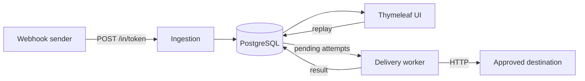

# HookDock

A self-hosted webhook inspector for developers: capture, inspect, forward and replay HTTP webhooks, with full delivery history.

Point GitHub, Stripe or any other webhook sender at a HookDock URL and you get:

- the exact request that was sent (raw body bytes, headers, query string, timestamp)
- optional forwarding to your own service, with the response, status code, latency or error recorded for every attempt
- one-click replay of a captured event once you've fixed your handler

HookDock is a single Spring Boot application backed by PostgreSQL. It is meant for individual developers and small teams who want something simple they can run themselves.

## Features

- **Projects and endpoints.** Each endpoint gets a random 256-bit receive URL (`/in/<token>`). Only a SHA-256 hash of the token is stored; the URL is shown once on creation.
- **Capture.** Raw request bytes are stored as received, so form bodies and signed payloads survive byte for byte. Credential headers (`Authorization`, `Cookie`, ...) are redacted before they are saved. Bodies over the size limit get a `413`.
- **Inspection.** Paginated event list per project, event detail page with headers, query string, raw body and pretty-printed JSON. Common providers (GitHub, Stripe, Shopify, Slack) are detected from their headers.
- **Approved destinations.** Forwarding and replay only send to destinations saved on the project. URLs are checked against an outbound policy (scheme, port, credentials in the URL, and every resolved IP must be public) when they are saved and again before each send.
- **Forwarding.** An endpoint can forward each captured event to a destination. Deliveries are queued in the database in the same transaction as the capture and sent by a background worker. Redirects are never followed.
- **Replay.** Re-send any captured event to an approved destination. Each replay is a new `MANUAL_REPLAY` attempt that records who requested it. The original event is never modified.
- **Delivery history.** Every attempt records trigger, status, HTTP status, duration, response headers, a response body excerpt and an error category. Capture status and delivery status are shown separately.
- **Accounts.** Form login backed by Spring Security, with CSRF protection on every form. Projects are only visible to their owner.

## Quick start

You need JDK 21 and Docker.

```bash
cp .env.example .env        # then fill in the DB and admin credentials
docker compose up -d postgres
set -a; source .env; set +a
./mvnw spring-boot:run
```

Or run everything in containers:

```bash
docker compose --profile app up --build
```

Open http://localhost:8080 and sign in with `HOOKDOCK_ADMIN_USERNAME` / `HOOKDOCK_ADMIN_PASSWORD` from your `.env`. The admin account is only created the first time the app starts with an empty user table.

Then:

1. Create a project and add an endpoint. Copy the receive URL - it is only shown once.
2. Send something to it:

   ```bash
   ./scripts/send-sample-webhook.sh http://localhost:8080/in/<token>
   ```

3. Open the project's events page to inspect it.

### Sending a batch of test requests

`scripts/load_test.py` sends a series of JSON webhooks to a receive URL and prints the outcome of each one (captured, rate limited, not found, too large or connection error) with a summary at the end. It only needs Python 3.8+, no extra packages, and works on macOS, Linux and Windows.

```bash
python3 scripts/load_test.py http://localhost:8080/in/<token> --count 50 --delay 0.1
```

On Windows, run it with `py` or `python` instead of `python3`. `--count` is the number of requests (default 10), `--delay` is the pause between requests in seconds (default 0.5, use 0 for none) and `--timeout` is the per-request timeout (default 10). Each request body includes its sequence number, so you can match the results to captured events.

### Trying forwarding locally

The outbound policy blocks loopback and private addresses unless `HOOKDOCK_ALLOW_PRIVATE_DESTINATIONS=true`. `.env.example` sets it to `true` so you can forward to a service on your own machine straight away. Add a destination like `http://localhost:9000/webhooks` (or `http://host.docker.internal:9000/webhooks` when HookDock runs in Docker), pick it in the endpoint's "Forward to" dropdown, and send another event.

Set it to `false` on any HookDock instance that other people can reach. If the variable isn't set at all, it defaults to `false`.

## Configuration

All configuration comes from environment variables (see `.env.example`). `.env` is gitignored; never commit it.

| Variable | Default | Purpose |
| --- | --- | --- |
| `HOOKDOCK_DB_URL` | `jdbc:postgresql://localhost:5432/hookdock` | JDBC URL |
| `HOOKDOCK_DB_USERNAME` | `hookdock` | Database user |
| `HOOKDOCK_DB_PASSWORD` | _(none)_ | Database password |
| `HOOKDOCK_ADMIN_USERNAME` | _(none)_ | First admin account, created only if no users exist |
| `HOOKDOCK_ADMIN_PASSWORD` | _(none)_ | Password for the first admin account |
| `HOOKDOCK_ALLOW_PRIVATE_DESTINATIONS` | `false` | Allow sending to loopback/private IPs (local dev only) |
| `HOOKDOCK_MAX_BODY_SIZE` | `1MB` | Largest inbound body that will be captured |
| `HOOKDOCK_PORT` | `8080` | HTTP port |

Delivery timeouts, worker poll interval and batch size are under `hookdock.delivery` in `application.yml`.

## Architecture



One deployable Spring Boot app, split into packages by feature:

```
dev.hookdock
├── projects/       projects and owner-scoped access checks
├── endpoints/      inbound endpoints, token generation and hashing
├── ingestion/      /in/{token} controller, capture, header redaction, size limits
├── events/         captured webhooks, event list/detail, payload formatting
├── destinations/   approved targets and the outbound URL/IP policy
├── delivery/       delivery attempts, worker, HTTP sender, replay
├── dashboard/      landing page
├── security/       login, users, current-user lookup
└── common/         shared bits
```

Delivery uses the database as the queue. Capturing an event and queuing its forward happen in one transaction. The worker polls for `PENDING` attempts and claims each one with a conditional update (`PENDING` -> `IN_PROGRESS`), so several app instances can run without sending the same attempt twice. The HTTP call itself runs outside any transaction.

Schema changes are managed with Flyway (`src/main/resources/db/migration`).

## Security notes

- Receive URLs are bearer secrets. Treat them like passwords. Tokens are never stored in plain text and are masked in the stored request path.
- `/in/**` is the only unauthenticated route that accepts writes, and it is exempt from CSRF because webhook senders cannot send a token. Everything else requires login and CSRF tokens.
- Outbound requests only go to saved destinations, never to a URL supplied with a replay request. The policy rejects non-HTTP schemes, credentials in the URL, unexpected ports, and any hostname that resolves to a loopback, private, link-local, CGNAT, unique-local, NAT64 or multicast address. It runs again before every send.
- Hop-by-hop headers, `Host`, `Authorization`, `Cookie` and forwarding headers are not copied onto outbound requests.
- **Known gap:** the policy resolves DNS and then the HTTP client resolves again when it connects, so a DNS rebinding attack has a small window. For any shared deployment, also restrict egress at the network level (firewall or egress proxy). Pinning the connection to the validated address is on the roadmap.
- Replays send the original body and headers. Providers that put a timestamp in the signature (Stripe, Slack) may reject replays as expired. HookDock does not re-sign requests.
- Replays can cause duplicate side effects in the target. Make your handlers idempotent.

## Running the tests

```bash
./mvnw verify
```

Tests use H2 in PostgreSQL mode with the real Flyway migrations, plus a small in-process HTTP server for delivery tests, so no Docker is required. CI runs the same command on GitHub Actions.

## Roadmap

See [ROADMAP.md](ROADMAP.md).

## License

MIT - see [LICENSE](LICENSE).
